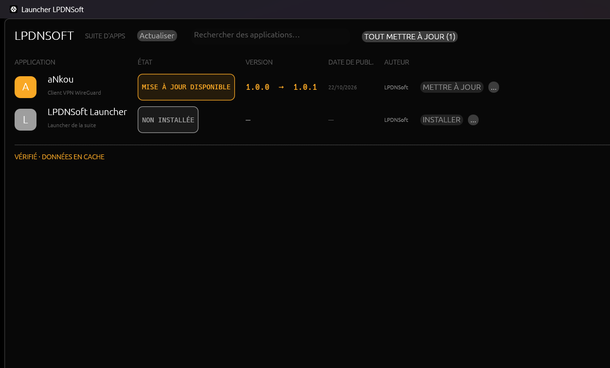

# lpdnsoft-launcher

Launcher de la suite **LPDNSoft** : il liste les applications de la suite, affiche leur version
installée et la dernière publiée, et les installe ou les met à jour depuis leurs releases GitHub.

Référence visuelle et fonctionnelle : le launcher ArtCraft (cité par la spec d'aNkou §1).

Suivi des tâches, priorités et décisions en attente : [`BACKLOG.md`](BACKLOG.md).



## État — v0.4

Ce qui marche :

- **Vraies releases** : une requête `GET /releases/latest` par application, sans intermédiaire
  ni jeton — version disponible et date de publication viennent de GitHub ;
- **Vraie version installée** : registre de désinstallation sous Windows, `dpkg-query`/`rpm -q`
  sur Linux, `pkgutil` sur macOS ; le nom du paquet vient du manifeste ;
- **Cache conditionnel** : l'empreinte part dans `If-None-Match`, un 304 ne coûte rien au
  quota, et une panne réseau retombe sur la dernière réponse connue ;
- **Téléchargement vérifié** (`crates/download`) : reprise par `Range`, empreinte `SHA-256`
  comparée à `SHA256SUMS`, publication atomique — pas encore branché à l'interface ;
- **États calculés** : à jour, mise à jour disponible, non installée, version inconnue ;
- **Interface complète** : pastilles d'état, recherche, menu par application, deux langues ;
- **Actions honnêtes** : ce qui n'existe pas est désactivé avec une infobulle ; « Site web »
  et « Dépôt GitHub » ouvrent le navigateur ;
- **Pied de page honnête** : jamais vérifié / en cours / vérifié / données en cache / échec ;
- 80 tests, `fmt` et `clippy -D warnings` propres, `cargo deny` sans avis.

Ce qui n'existe pas encore :

- aucune installation ni mise à jour : le téléchargement vérifié n'est pas encore branché ;
- une application installée hors gestionnaire de paquets (archive, binaire copié, Flatpak)
  reste invisible : l'interface affiche alors « version inconnue ».

## Compiler et lancer

Prérequis : Rust stable ≥ 1.95 et le dépôt `lpdnsoft-libs` cloné **à côté** de celui-ci.

```sh
cargo run -p lpdnsoft-launcher            # langue du système
cargo run -p lpdnsoft-launcher -- --lang fr
cargo xtask ci                             # fmt, clippy, tests, cargo deny
```

## Architecture

```
crates/core   catalogue, versions, états — aucune E/S
crates/ui     interface egui (thème lpdnsoft-ui), données de démonstration
apps/launcher binaire : arguments, journal, lancement de la fenêtre
```

Décisions et limites : `docs/adr/0001-architecture.md`.

Licence : MIT. Le texte est dans `LICENSE-MIT` ; le manifeste le déclare, et un test
vérifie que la déclaration et les fichiers livrés ne divergent pas.
